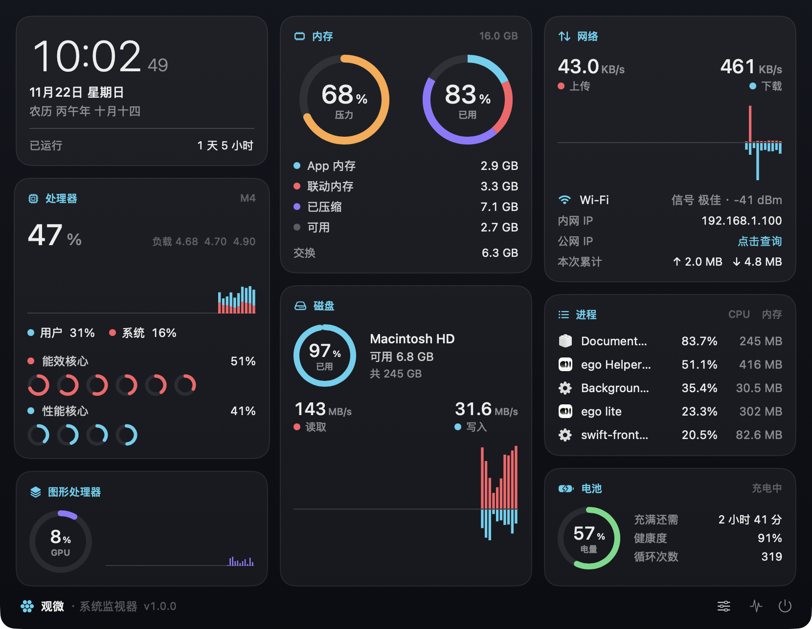
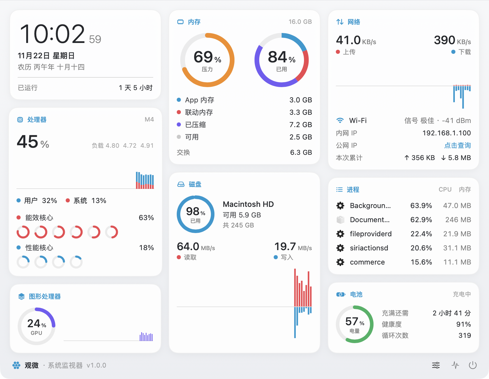
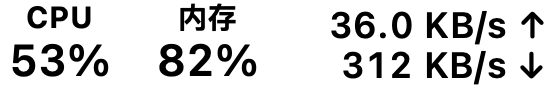

<div align="center">


# 观微 GuanWei

**简约美观的 macOS 菜单栏系统监视器**

原生 SwiftUI · 全中文界面 · 浅色 / 深色 · 零依赖 · 不到 1 MB

[](https://github.com/245678000000/GuanWei/releases/latest)


[](LICENSE)

[下载](#-安装) · [功能](#-功能) · [从源码构建](#-从源码构建) · [常见问题](#-常见问题)

</div>

---

<p align="center">
  
  
</p>

<p align="center">
  
  <br><sub>菜单栏一眼掌握 CPU、内存与网速</sub>
</p>

## ✨ 功能

| 模块 | 内容 |
| --- | --- |
| 🕐 **时钟** | 时间、日期、**农历**（如「丙午年 十月十四」）、开机时长 |
| 🧠 **处理器** | 总占用率、用户 / 系统占用历史柱状图、**能效核心与性能核心**逐核圆环、系统负载 |
| 💾 **内存** | 内存压力、已用分段圆环（App 内存 / 联动内存 / 已压缩）、可用、交换 |
| 🗄 **磁盘** | 容量占用、实时读写速率与波形 |
| 🌐 **网络** | 上传 / 下载速率与对称波形、Wi‑Fi 信号强度、内网 IP、公网 IP、本次累计流量 |
| 📋 **进程** | CPU 占用最高的 5 个进程，带应用图标与内存占用 |
| 🎮 **图形处理器** | GPU 占用率与历史 |
| 🔋 **电池** | 电量、充电状态、剩余时间、健康度、循环次数 |

此外还有：

- **菜单栏显示**：CPU、内存、网速可分别开关，图标随菜单栏明暗自动适配
- **外观**：跟随系统 / 浅色 / 深色
- **登录时启动**
- **检查更新**：基于 GitHub Releases，每 6 小时自动检查，也可手动检查；一键下载、替换并重启
- **轻量**：每秒采样一次，全部使用系统原生接口，无第三方依赖

## 📦 安装

1. 前往 [Releases](https://github.com/245678000000/GuanWei/releases/latest) 下载最新的 `GuanWei-x.y.z.zip`
2. 解压，把 **观微.app** 拖进「应用程序」文件夹
3. 打开后，观微会出现在菜单栏，点击即可展开面板

> [!NOTE]
> 观微使用临时签名（未经 Apple 公证）。首次打开如提示「无法验证开发者」，请在 Finder 中**右键 → 打开**，
> 或前往「系统设置 → 隐私与安全性」点击「仍要打开」。也可以在终端执行：
>
> ```bash
> xattr -dr com.apple.quarantine /Applications/观微.app
> ```

> [!TIP]
> 如果菜单栏里看不到观微，可能是被刘海或 Bartender / Ice 等菜单栏管理工具隐藏了，请在对应工具中将其设为常显。

**系统要求**：macOS 14 Sonoma 或更高版本，Apple 芯片与 Intel 均可。

## ⚙️ 使用

点击面板右下角的 <kbd>⚙︎</kbd>（滑块图标）打开设置：

- **菜单栏显示**：CPU 使用率 / 内存占用 / 网络速率
- **外观**：跟随系统 / 浅色 / 深色
- **登录时启动**
- **检查更新… / 自动检查更新**

右下角另外两个按钮分别是打开「活动监视器」和退出。

## 🛠 从源码构建

只需要 Swift 工具链（Xcode 或 Command Line Tools 均可），无需 Xcode 工程。

```bash
git clone https://github.com/245678000000/GuanWei.git
cd GuanWei
./build.sh               # 生成 build/观微.app 与 build/GuanWei-<版本>.zip
open build/观微.app
```

开发调试时，可以用普通窗口预览面板：

```bash
swift build
.build/debug/GuanWei --window --appearance dark    # light / dark / system
```

| 参数 | 作用 |
| --- | --- |
| `--window` | 以普通窗口显示面板，便于调试界面 |
| `--appearance <模式>` | 配合 `--window` 指定外观 |
| `--demo` | 演示模式，隐藏真实内网 IP（用于截图） |
| `--icon <路径>` | 渲染 1024×1024 应用图标 |

### 发布新版本

```bash
./release.sh 1.1.0 "更新说明"
```

脚本会更新 `VERSION`、打包、提交并推送 tag，然后创建 GitHub Release 并上传 zip。
已安装的观微会在下次检查时发现新版本。

## 🧩 项目结构

```
Sources/GuanWei/
├── App.swift          # 入口、菜单栏、调试窗口与图标渲染
├── Monitor.swift      # 采样调度、历史数据、格式化、偏好设置
├── Samplers.swift     # 各项指标的系统采集
├── Dashboard.swift    # 面板各卡片与页脚
├── Components.swift   # 主题色、圆环、图表等通用组件
└── Updater.swift      # 基于 GitHub Releases 的检查更新
```

### 数据来源

全部来自 macOS 原生接口，无需管理员权限：

| 指标 | 接口 |
| --- | --- |
| CPU / 每核占用 | `host_processor_info` |
| 能效 / 性能核心数 | `sysctl hw.perflevel{0,1}.logicalcpu` |
| 内存 | `host_statistics64`、`kern.memorystatus_level`、`vm.swapusage` |
| 磁盘读写 | IOKit `IOBlockStorageDriver` 统计 |
| 网络 | `getifaddrs` + `if_data`、CoreWLAN |
| GPU | IOKit `IOAccelerator` 的 `PerformanceStatistics` |
| 电池 | `IOPowerSources`、`AppleSmartBattery` |
| 进程 | `libproc`（`proc_pidinfo`） |

## 🔒 隐私

观微不收集、不上传任何数据。只有以下两种情况会联网：

- **公网 IP**：仅在你点击「点击查询」时请求 `api.ipify.org`
- **检查更新**：请求 GitHub API 获取最新发行版（可在设置中关闭自动检查）

## ❓ 常见问题

**为什么不显示 Wi‑Fi 名称？**
新版 macOS 读取 Wi‑Fi 名称需要定位权限，观微不申请该权限，因此只显示信号强度。

**能显示 CPU 温度和风扇转速吗？**
暂不支持。Apple 芯片上需要读取 SMC 传感器，计划在后续版本加入。

**内存压力和「活动监视器」不完全一致？**
观微使用 `kern.memorystatus_level` 估算内存压力，与活动监视器的算法略有差异，趋势一致。

**「登录时启动」不生效？**
请先把观微放进「应用程序」文件夹再开启。

## 🤝 参与贡献

欢迎提交 Issue 和 Pull Request！提交前请确保 `swift build` 可以通过。

## 📄 许可证

[MIT](LICENSE) © 2026 TianTian
